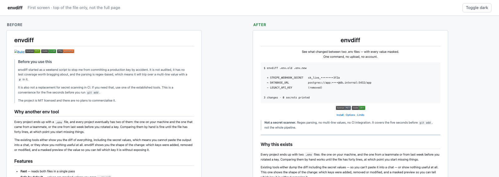

<h1 align="center">README Visual Design</h1>

<p align="center">An agent skill that revamps the opening screen of a GitHub README.<br>
It ships the two things most README skills don't: an audit that catches broken output, and a preview that lets you see the result before you push.</p>

<p align="center">
  
  <br>
  <sub>Generated by running the two scripts on <a href="examples/envdiff">examples/envdiff</a> — a made-up CLI project, not a real one.</sub>
</p>

<p align="center">
  <a href="LICENSE"></a>
  <a href="https://www.python.org/"></a>
  <br>
  <sub><a href="#why-another-readme-skill">Why</a> · <a href="#the-eight-opening-paradigms">Paradigms</a> · <a href="#what-the-audit-looks-like">Audit</a> · <a href="#install">Install</a> · <a href="#limits">Limits</a></sub>
</p>

---

## Why another README skill

Most of them are a pile of prompts: center the title, add badges, fold the long sections. None of them can tell you whether the badge URL you just generated actually resolves, whether the image path survives a rename, or whether the "after" is genuinely better than the "before". You find out after pushing.

This one carries two tools, both plain Python with no dependencies:

| Tool | What it does |
| --- | --- |
| `scripts/check_readme.py` | Rule-based audit: broken image paths, empty `#` links, malformed shields.io URLs, dead in-page anchors, heading level jumps, malformed alerts, unclosed `<details>`, table column drift, oversized images. It also prints the order of elements on the opening screen — the fact the diagnosis depends on. |
| `scripts/preview_firstscreen.py` | Renders the opening screen before and after, side by side, at GitHub's real body width (1012px), light and dark, with images inlined so the HTML can be sent to anyone. |

Everything else — the judgment about *what* to change — lives in `SKILL.md` and `references/`.

## What it actually decides

Markdown gives you structure, hierarchy, whitespace and assets. Font size, color and spacing are all stripped by GitHub. So the work is not styling. It is answering five questions, in this order:

1. **Who is reading** — fellow developers, prospective users, recruiters, or the author archiving their own work?
2. **What lands in the first 8 seconds** — list the elements actually visible, in order. Most problems are ordering problems, not missing elements.
3. **Is there visual proof** — and is it a screenshot of the *output*, or just of the UI? The second one is worthless.
4. **Which opening paradigm** — one of eight, chosen by project type and available assets, with the reasoning stated.
5. **What gets folded, what gets cut** — `<details>` for optional depth, deletion for everything that only mattered to the author.

## The eight opening paradigms

| # | Paradigm | Best for |
| --- | --- | --- |
| 1 | Centered logo | CLI tools, libraries, frameworks that have a real logo |
| 2 | Demo first | Anything with visible output — the strongest option for visual products, and the most often wasted |
| 3 | Terminal anchor | Pure developer tools with no screenshot worth showing |
| 4 | Comparison matrix | Libraries with obvious alternatives |
| 5 | Dense directory | Collections, lists, template sets |
| 6 | Minimal statement | Experimental projects, strong author voice, internal tools |
| 7 | Screenshot grid | Themes, UI kits, component libraries |
| 8 | Status board | Cross-platform libraries that have to prove compatibility |

Each one comes with a skeleton you can copy, the reason to pick it, and its failure mode. See [`references/opening-paradigms.md`](references/opening-paradigms.md).

## What the audit looks like

Run on the "before" version in [`examples/envdiff/`](examples/envdiff) — a made-up first draft, kept in the repo so you can reproduce this:

```
■ examples/envdiff/README.before.md
  Lines: 65  Headings: 7  Images: 4

  First-screen element order (what readers actually see first):
       1  Heading
       3  Badge
       4  Badge
       5  Badge
       6  Badge
       8  Quote/alert block
       9  Quote/alert block
      10  Quote/alert block
      11  Quote/alert block
      12  Quote/alert block

  Diagnostic hints (structure, not errors):
    - First screen opens with a quote/alert block, image or result below
      — author view beating reader view
    - 4+ badges in a row on the first screen: more visual noise than signal

  ERROR:
        L6  Badge links to `#`: clicking it jumps to the top of the page

  Total: 1 errors, 0 warnings
```

The error is mechanical — that badge was never going anywhere. The two hints are judgment calls: the page leads with a disclaimer and four badges that tell the reader nothing. A linter gives you the first. The skill layer is what turns the second into a decision about which paradigm to use.

## Install

```bash
git clone https://github.com/zyphraxns/readme-visual-design.git
```

Then put the folder where your agent looks for skills:

- **Claude Code** — `~/.claude/skills/readme-visual-design`
- **Any agent that loads `SKILL.md` folders** — point it at this directory

No build step. `check_readme.py` uses only the standard library. `preview_firstscreen.py` needs `markdown` (`python -m pip install markdown`); without it the skill skips the preview and hands you the revised README plus the change log instead.

## Use

Three prompts that trigger it:

```
My README has decent content but nobody stars the repo. The opening is weak.
Point the skill at ./README.md and rework it.
```

```
Audit this README. I want to know what's structurally wrong before I rewrite anything.
```

```
I'm about to publish this repo. Make the first screen work.
```

It will read the repo for facts, diagnose, pick a paradigm, and only then rewrite. It does not commit — it leaves you a `git diff` and a change log.

## Limits

Being specific about what this doesn't do is cheaper than having you find out mid-task.

- **GitHub only.** GitHub-flavored alerts, `<picture>` dark mode and `<details>` all degrade on Gitee, GitLab and Notion. The reference file says what to fall back to, but the skill is tuned for GitHub's renderer.
- **The paradigm library is opinionated and partly untested.** Two of the eight have been validated against real repositories; the rest are reasoned but unproven. Treat them as starting points, not law.
- **The preview is approximate.** It renders through `python-markdown` at GitHub's content width. Line heights and font metrics differ slightly; use it to judge structure and hierarchy, not pixels.
- **It won't write a README from scratch.** It revamps one that already has content. If there is nothing there to work with, it will say so rather than invent a project.

## Contributing

New paradigms, new audit rules and reports of bad revamps are all welcome. Read [CONTRIBUTING.md](CONTRIBUTING.md) first — it explains the two ways to extend the skill and the one rule for the docs (every rule has to explain why).

## License

[MIT](LICENSE) © 2026 zyphraxns
